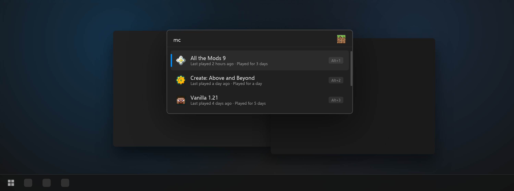

<!-- generated by readwright from docs/README.md.j2; edit the template, not this file -->


# Minecraft Multi Launcher

Launch your MultiMC, PolyMC and Prism Launcher instances straight from Flow Launcher.

[](https://github.com/Garulf/MC-Multi-Launcher/actions/workflows/tests.yml) [](https://github.com/Garulf/MC-Multi-Launcher/releases/latest)

[](https://www.buymeacoffee.com/garulf) [](https://github.com/sponsors/Garulf)

## Features

* **Every launcher at once.** Finds MultiMC, PolyMC and Prism Launcher on its own and lists the instances from all of them.
* **Recent first.** Instances are sorted by when you last played them, with your total play time alongside.
* **Fuzzy matching.** `mc atm` finds All the Mods 9.
* **Your icons.** Built-in, custom and modpack icons show up next to each instance.
* **Portable installs.** Point it at any launcher folder or `.exe` and it reads the instances from there.
* **Context menu.** `Shift+Enter` on an instance to open its folder or the launcher itself.

## Usage

Type `mc` to see your instances, most recently played first:

```
mc
```


Keep typing to search, then press `Enter` to launch:

```
mc create
```


## Installation

### Flow Launcher

In Flow Launcher, type:

```
pm install minecraft multi launcher
```


### Manual installation

Download the zip from the [latest release](https://github.com/Garulf/MC-Multi-Launcher/releases/latest) and unzip it into
`%appdata%\FlowLauncher\Plugins`, then restart Flow Launcher.

Pre-releases of the next version are published from the open release PR on the
[releases page](https://github.com/Garulf/MC-Multi-Launcher/releases) for testing. Flow Launcher won't offer them as updates.

## Settings

The plugin looks for launchers in `%LOCALAPPDATA%\Programs`, `%LOCALAPPDATA%`, `%APPDATA%`,
`Program Files` and Scoop. If yours lives somewhere else, set **Launcher folder** in the plugin
settings to the folder that contains `MultiMC.exe`, `polymc.exe` or `prismlauncher.exe` (or to
the `.exe` itself). Only that launcher is used while the setting is filled in.

## Development

```
tox                    # tests on every supported Python
tox -e screenshots     # re-render .github/assets with flow-render
tox -e readme          # re-render README.md
python scripts/build.py --zip build/MC-Multi-Launcher.zip
```

## Changelog

### [2.0.0](https://github.com/Garulf/MC-Multi-Launcher/compare/v1.2.2...v2.0.0) (2026-10-03)

#### ⚠ BREAKING CHANGES

* the plugin now runs on Flow Launcher's Python runtime (python_v2) instead of a bundled executable, and the "select a launcher" results are gone in favour of auto-detection.

#### Features

* port to pyflowlauncher and the python_v2 runtime ([cbf4add](https://github.com/Garulf/MC-Multi-Launcher/commit/cbf4addfb828864b00334e5812f005f33c67ae13))

#### Bug Fixes

* crashes after prismlauncher update ([7f7c7f8](https://github.com/Garulf/MC-Multi-Launcher/commit/7f7c7f863628739f7749090449e10f1c0ab31cd1))

### [1.2.2](https://github.com/Garulf/MC-Multi-Launcher/compare/v1.2.1...v1.2.2) (2024-07-01)

#### Bug Fixes

* work with newer Prism Launcher config files ([#10](https://github.com/Garulf/MC-Multi-Launcher/pull/10))

### [1.2.1](https://github.com/Garulf/MC-Multi-Launcher/compare/v1.2.0...v1.2.1) (2023-02-23)

#### Bug Fixes

* show an error message when the launcher config can't be found

See [CHANGELOG.md](CHANGELOG.md) for the full history.
